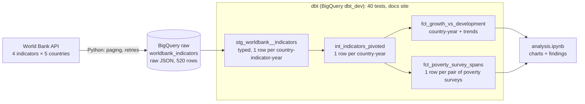
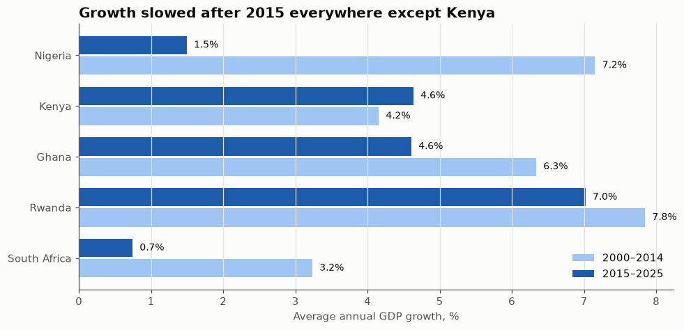
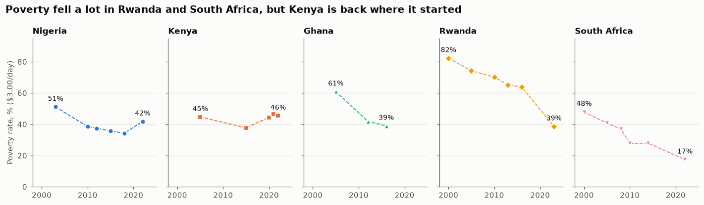
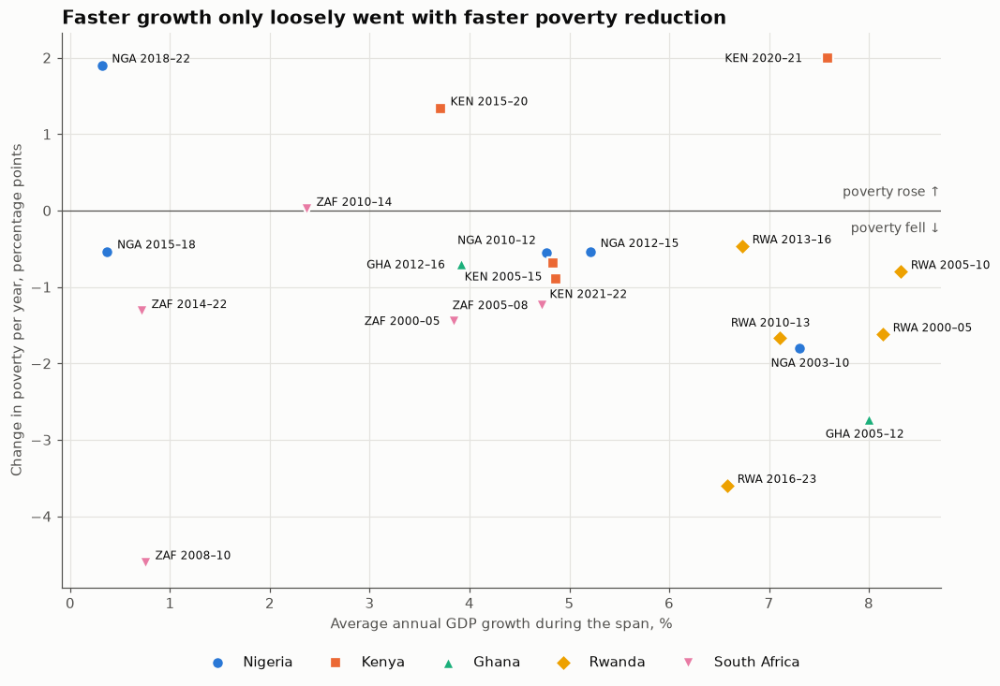

# Growth vs. Development

**Does GDP growth translate into broad-based development (less poverty, more jobs, wider mobile access) in Nigeria, Kenya, Ghana, Rwanda and South Africa, 2000–2025?**

An end-to-end ELT pipeline: World Bank API → Python → BigQuery → dbt → Jupyter.

**Short answer: only partly.** Across 21 pairs of poverty surveys, growth and poverty reduction barely moved together (correlation about −0.1). Rwanda grew fastest and cut poverty the most, but South Africa cut poverty with almost no growth, and Kenya grew steadily while poverty ended where it started. [Findings below](#findings).

---

## Architecture



| Layer | What happens | Why |
| --- | --- | --- |
| **Ingestion** (`ingestion/`) | Pulls every page from the API, with retries and backoff. Stores each record **unchanged** as JSON text, with load metadata | ELT: if a transform has a bug, the raw data is still there to rebuild from |
| **Load** | `WRITE_TRUNCATE`: each run replaces the table | Re-running is safe (idempotent): no duplicates |
| **Staging** | Rename, cast, extract from JSON. No filtering | One clean, typed row per country, indicator and year |
| **Intermediate** | Pivot long → wide | One row per country-year, every indicator side by side |
| **Marts** | Two tables at two grains | Poverty is only surveyed every few years, so it gets its own survey-to-survey mart instead of being forward-filled |

**Stack:** Python 3.12 · BigQuery · dbt-core 1.12 with dbt-bigquery and dbt_utils · pandas · matplotlib · pytest

## Data

| Indicator | World Bank code | Coverage |
| --- | --- | --- |
| GDP growth, annual % | `NY.GDP.MKTP.KD.ZG` | 2000–2025, every year |
| Poverty, % below **$3.00/day** (2021 PPP) | `SI.POV.DDAY` | **Only 3–6 survey years per country** |
| Unemployment, % of labour force (modelled ILO estimate) | `SL.UEM.TOTL.ZS` | 2000–2025 |
| Mobile subscriptions per 100 people | `IT.CEL.SETS.P2` | 2000–2024 |

Countries, years and indicators are set in [`config/indicators.yml`](config/indicators.yml). The ingestion code and the notebook both read that file, so they can't disagree about what's in scope.

**Data notes:**
- The World Bank moved the extreme poverty line from $2.15 to **$3.00 a day** in 2025. Older articles quote different poverty numbers.
- The World Bank revises past values. Each raw row keeps the indicator's `source_last_updated` date and the pipeline's `ingested_at` timestamp, and `dbt source freshness` warns when the data is more than 35 days old.
- Missing years come back from the API as rows with a null value. They're kept as nulls, never filled in.

## Data quality

40 dbt tests run on every `dbt build`, at every layer:

- **Grain** (`unique_combination_of_columns`) on the source and every model: catches double loads and join fan-out.
- **Accepted values** on countries and indicator names: catches scope changes that weren't mapped through.
- **Ranges** on percentages (0–100). GDP growth outside ±30% only **warns**, because extreme values can be real (wars, pandemics).
- **Row counts:** the country-year mart must have exactly as many rows as the pivot.
- **A custom test** checks that the pivot never loses a value. I broke the pivot on purpose to watch it fail, and `dbt build` skipped both marts, so bad data never reached them.

Plus 7 pytest unit tests for the ingestion code (combining pages, turning API records into rows, keeping nulls), which run without calling the API.

## Findings

Full analysis, with one chart per question: [`notebooks/analysis.ipynb`](notebooks/analysis.ipynb).

**1. Growth slowed after 2015 everywhere except Kenya.** Nigeria fell from 7.2% to 1.5% a year, and South Africa from 3.2% to 0.7%. Rwanda stayed around 7%.



**2. Poverty fell in four of five countries, by very different amounts.** Rwanda went from 82% to 39% and South Africa from 48% to 17%. Kenya ended where it started (45% → 46%), and Nigeria's poverty rose again after 2018.



**3. Faster growth only loosely went with faster poverty reduction.** Each dot is one pair of back-to-back surveys. Poverty fell in 17 of 21 spans, but how fast it fell had little to do with how fast the economy grew. The outliers tell the story: South Africa cut poverty on growth below 1%, while Kenya grew 3.7% a year from 2015 to 2020 and poverty *rose*.



**4. Growth didn't bring unemployment down.** South Africa's rose from 23% to 32%. Only Ghana improved clearly (10.5% → 3.0%).

**5. Mobile access spread everywhere, whatever the growth rate:** from almost nothing in 2000 to 70–180 subscriptions per 100 people by 2024.

### Scorecard

| Country | Avg GDP growth 2000–25 | Poverty: first → latest survey | Poverty change | Unemployment 2000 → 2025 | Mobile per 100 (2024) |
| --- | --- | --- | --- | --- | --- |
| Nigeria | 4.8% | 51.1% (2003) → 41.8% (2022) | −9.3 pp | 4.0% → 3.1% | 71 |
| Kenya | 4.4% | 44.6% (2005) → 45.5% (2022) | +0.9 pp | 2.9% → 5.4% | 126 |
| Ghana | 5.6% | 60.9% (2005) → 39.0% (2016) | −21.9 pp | 10.5% → 3.0% | 114 |
| Rwanda | **7.5%** | 82.3% (2000) → 38.6% (2023) | **−43.7 pp** | 11.7% → 11.4% | 93 |
| South Africa | 2.2% | 47.9% (2000) → 17.4% (2022) | −30.5 pp | 22.8% → **32.4%** | 179 |

pp = percentage points. Read across a row to see one country's story: Rwanda had the fastest growth and the biggest fall in poverty; South Africa had the slowest growth, yet the second-biggest fall in poverty, while unemployment rose.

**Conclusion:** growth helped but didn't guarantee better lives. Who benefits from growth mattered as much as how fast it was.

## Limitations

1. **Poverty data is sparse:** 3–6 surveys per country, and Ghana's latest is 2016. Changes between surveys can partly reflect changes in survey methods.
2. **Unemployment is a modelled estimate** and misses informal work, so low rates in Nigeria, Kenya and Ghana don't mean healthy job markets.
3. **Mobile counts subscriptions, not people.** Sudden drops (Ghana 2023, Nigeria 2024) probably reflect SIM-registration rules.
4. **Small sample:** 5 countries and 21 survey spans. These are patterns, not proof.
5. **Correlation, not causation.** Factors such as social grants, oil prices and population growth aren't in the data.
6. **GDP growth isn't per person.** With populations growing 2–3% a year, growth per person is much lower.

**Next steps:** add population to get growth per person, add a job-quality measure such as informal employment, and schedule the pipeline monthly with Airflow.

## How to run it

**You need:** Python 3.12, the [gcloud CLI](https://cloud.google.com/sdk/docs/install), and a Google Cloud project with BigQuery enabled. The free BigQuery sandbox is enough; the whole dataset is under 1 MB. (Sandbox tables are deleted after 60 days; re-run steps 3 and 4 to rebuild them.)

```bash
# 1. Install
cd growth_vs_econdev
python3.12 -m venv .venv && source .venv/bin/activate
pip install -r requirements.txt

# 2. Log in to Google Cloud (dbt and the Python code use these credentials)
gcloud auth application-default login
# Then set your own project id in config/indicators.yml and econdev_dbt/profiles.yml,
# and create two datasets in BigQuery (location US): raw and dbt_dev

# 3. Extract and load: World Bank API -> BigQuery raw
python -m ingestion.ingest

# 4. Transform and test: build every model, running its tests straight after it
cd econdev_dbt
dbt deps                    # installs dbt_utils (once)
dbt source freshness        # is the raw data recent enough?
dbt build                   # 4 models + 40 tests
dbt docs generate && dbt docs serve    # docs site with the lineage graph

# 5. Unit tests for the ingestion code (from growth_vs_econdev/)
cd .. && python -m pytest tests -v

# 6. The analysis
jupyter lab notebooks/analysis.ipynb
```

If `dbt deps` fails with an SSL certificate error on macOS, run `export SSL_CERT_FILE=$(python -m certifi)` first.

## Project layout

```
growth_vs_econdev/
├── config/indicators.yml      # scope: countries, years, indicators, BigQuery target
├── ingestion/                 # extract + load (API client, loader)
├── tests/                     # pytest unit tests for ingestion
├── econdev_dbt/
│   ├── models/staging/        # stg_worldbank__indicators + source definition and freshness
│   ├── models/intermediate/   # int_indicators_pivoted
│   ├── models/marts/          # fct_growth_vs_development, fct_poverty_survey_spans
│   └── tests/                 # custom test: the pivot keeps every value
├── notebooks/
│   ├── exploratory.ipynb      # Phase 1: understanding the API before building
│   └── analysis.ipynb         # the findings
├── docs/                      # README images, demo walkthrough
└── LEARNING_NOTES.md          # concepts, decisions and interview Q&A per phase
```

**Walkthrough:** [`docs/WALKTHROUGH.md`](docs/WALKTHROUGH.md) traces one number from the final chart back to the raw API record.
